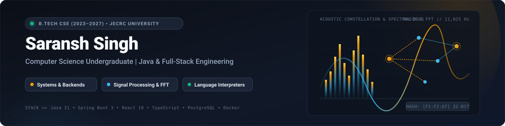
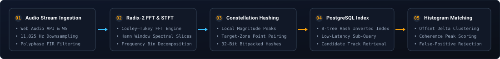
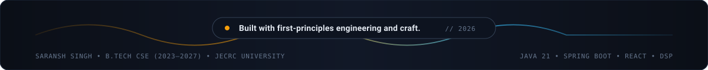

<div align="center">

<picture>
  <source media="(prefers-color-scheme: dark)" srcset="assets/header-dark.svg">
  <source media="(prefers-color-scheme: light)" srcset="assets/header-light.svg">
  
</picture>

<br><br>

<p align="center">
  <a href="https://sars-23.github.io/Portfolio/"></a>
  <a href="https://github.com/sars-23/Amber_Project"></a>
  <a href="mailto:saransh.9822@gmail.com"></a>
</p>

</div>

---

<picture>
  <source media="(prefers-color-scheme: dark)" srcset="assets/section-about.svg">
  <source media="(prefers-color-scheme: light)" srcset="assets/section-about-light.svg">
  
</picture>

I am a Computer Science undergraduate at **JECRC University (2023–2027)** focused on backend engineering, Java systems architecture, and first-principles software design.

Rather than treating modern frameworks and external libraries as opaque abstractions, I enjoy deconstructing complex systems to their mathematical and computational foundations. Whether engineering a custom Cooley–Tukey Fast Fourier Transform (FFT) for audio fingerprinting, implementing a handwritten recursive-descent compiler interpreter, or structuring isolated container execution sandboxes, my goal is always the same: **understand the system from first principles and build robust, deterministic software.**

```java
public record DeveloperIdentity(
    String engineer,
    String academicDegree,
    String institutionalAffiliation,
    String corePhilosophy,
    List<String> activeFocusAreas
) {
    public static final DeveloperIdentity SARANSH = new DeveloperIdentity(
        "Saransh Singh",
        "B.Tech in Computer Science & Engineering (2023–2027)",
        "JECRC University, Jaipur",
        "Understand foundational mechanics; engineer deterministic systems.",
        List.of(
            "Java 21 & Spring Boot 3 Backend Systems",
            "Full-Stack Web Architecture & Real-Time Streams",
            "Digital Signal Processing & Algorithmic Audio Search",
            "Compiler Frontends & Abstract Syntax Tree Interpreters",
            "Relational Schema Design & B-tree Index Optimization"
        )
    );
}
```

---

<picture>
  <source media="(prefers-color-scheme: dark)" srcset="assets/section-projects.svg">
  <source media="(prefers-color-scheme: light)" srcset="assets/section-projects-light.svg">
  
</picture>

### 👑 Amber — Real-Time Acoustic Fingerprinting & Music Recognition Platform

> **Flagship Engineering Project** • *Engineered from first principles in Java 21, Spring Boot 3, and React 19 without third-party recognition APIs or numerical math packages.*

<div align="center">
  <picture>
    <source media="(prefers-color-scheme: dark)" srcset="assets/amber-pipeline-dark.svg">
    <source media="(prefers-color-scheme: light)" srcset="assets/amber-pipeline-light.svg">
    
  </picture>
</div>

<br>

Amber is a distributed acoustic fingerprinting and audio identification system capable of recognizing music in real time through a browser microphone or uploaded audio file. Instead of delegating recognition to proprietary cloud APIs, Amber executes an end-to-end discrete digital signal processing pipeline:

* **Custom Radix-2 Cooley–Tukey FFT & STFT Framing:** Transforms incoming continuous time-domain PCM samples into frequency-domain spectral slices using sliding Hann windows, decomposing raw audio across discrete frequency bins.
* **Combinatorial Constellation Hashing:** Extracts local magnitude peaks within logarithmic frequency intervals and generates compact 32-bit hashes `[f1:f2:Δt]` by pairing anchor points with target peaks inside a forward time-frequency bounding box.
* **Inverted B-Tree Candidate Retrieval:** PostgreSQL candidate retrieval evaluates fingerprint hashes against reference indexes, drastically reducing the search space across indexed tracks.
* **Time-Coherent Offset Histogram Matching:** Computes offset deltas `(t_track - t_query)` across matched hashes. A true positive manifests as a sharp statistical peak in the offset histogram, isolating signal from ambient acoustic noise.
* **Browser Microphone Streaming via AudioWorklet:** Continuously samples live input at 11,025 Hz using a native client-side AudioWorklet downsampler with polyphase FIR filtering and WebSockets transport.
* **Deterministic Noise Lab Benchmark:** An in-memory evaluation lab that injects synthetic white noise, frequency attenuation, and temporal jitter to rigorously test false-positive rejection thresholds.

<p align="left">
  <a href="https://amber-frontend-w78m.onrender.com"><b>🌐 Live Production Application</b></a> &nbsp;•&nbsp;
  <a href="https://github.com/sars-23/Amber_Project"><b>📦 GitHub Source Repository</b></a> &nbsp;•&nbsp;
  <a href="https://sars-23.github.io/Portfolio/"><b>📑 Architecture Case Study</b></a>
</p>

---

### 🌿 Arbor — Dynamically Typed Programming Language Interpreter

> **Compiler Architecture & Systems** • *Java • Lexical Scanner • Recursive-Descent Parser • AST Visitor Pattern • Swing Mini-IDE*

Arbor is an interpreted programming language implemented in Java, featuring a custom lexer, parser, and tree-walk evaluation runtime:

* **Handwritten Lexical Scanner:** Implemented without parser generators (such as ANTLR or Flex), streaming tokens while maintaining line and column source mappings for precise syntax error reporting.
* **Recursive-Descent Parser:** Translates token streams into an Abstract Syntax Tree (AST) supporting operator precedence, nested expressions, variable declarations, and control flow constructs.
* **Tree-Walk Evaluation Engine:** Utilizes the Visitor Pattern to traverse AST nodes with support for lexical scoping, environment stacking, and first-class closures.
* **Integrated Developer Environment:** Includes a lightweight Java Swing mini-IDE featuring syntax highlighting, live token inspection, and an interactive execution REPL.

*Status: Private codebase. Formal grammar specifications and execution models are documented on the [portfolio website](https://sars-23.github.io/Portfolio/).*

---

### 🌰 Project Apricorn — Developer Growth & Practice Engine

> **Backend Architecture & Execution Sandboxing** • *Java 21 • Spring Boot • Docker • PostgreSQL • Flyway*

A developer practice platform designed to evaluate and guide programmatic problem-solving progression:

* **Docker Execution Sandbox:** Executes untrusted code inside isolated ephemeral containers with strict CPU time quotas, memory bounds, and disabled network access.
* **Solution Journey Progression:** Tracks iterative code attempts over time, providing granular historical snapshots and deterministic insights into developer refinement patterns.
* **Database Persistence:** Managed through Flyway schema migrations, backed by PostgreSQL relational models for user submissions, problem test fixtures, and telemetry.

*Status: Private codebase. Full architectural overview and interface designs are documented on the [portfolio website](https://sars-23.github.io/Portfolio/).*

---

### 📇 Java Contact Management System

> **Object-Oriented Design & Desktop Application** • *Java • Java Swing • In-Memory Data Structures*

A responsive desktop CRUD management application emphasizing decoupled UI architecture and efficient data indexing:

* **$O(1)$ In-Memory Indexing:** Backed by a `LinkedHashMap` to guarantee constant-time record retrieval, updates, and deletions while strictly preserving insertion order.
* **Input Validation Engine:** Enforces validation rules for emails, regional phone numbers, and street addresses with real-time UI feedback.
* **Layered Architecture:** Separates Java Swing event dispatch threads from the underlying in-memory storage manager.

<p align="left">
  <a href="https://github.com/sars-23/Java_Contact_Management_System"><b>📦 GitHub Source Repository</b></a>
</p>

---

### 👁️ Real-Time Drowsiness Detection Prototype

> **Computer Vision & Geometric Modeling** • *Python • OpenCV • MediaPipe Face Mesh*

An experimental computer-vision prototype built to explore real-time facial landmark detection and temporal fatigue thresholds:

* **468-Point Facial Mesh:** Utilizes MediaPipe to extract 3D facial coordinate landmarks in real time.
* **Eye Aspect Ratio (EAR):** Computes Euclidean distances between eyelid landmarks to identify sustained blinks and micro-sleep events.
* **Mouth Aspect Ratio (MAR):** Measures lip displacement vectors to detect repetitive or prolonged yawning behavior.

*Note: Developed as an experimental educational prototype to explore facial topology algorithms; not intended as a certified automotive safety device.*

<p align="left">
  <a href="https://github.com/sars-23/real-time-drowsiness-detection"><b>📦 GitHub Source Repository</b></a>
</p>

---

<picture>
  <source media="(prefers-color-scheme: dark)" srcset="assets/section-stack.svg">
  <source media="(prefers-color-scheme: light)" srcset="assets/section-stack-light.svg">
  
</picture>

<div align="center">
  
</div>

<br>

| Category | Primary Technologies &amp; Tooling |
| :--- | :--- |
| **Languages** | Java (21 LTS), Python, C++, TypeScript, JavaScript, SQL |
| **Backend &amp; Runtimes** | Spring Boot 3, Spring MVC, REST APIs, WebSockets, AudioWorklet Streams |
| **Frontend &amp; UI** | React 19, TypeScript, HTML5, CSS3, Tailwind CSS, Java Swing |
| **Databases &amp; Storage** | PostgreSQL, MySQL, B-tree Inverted Indexing, In-Memory Caching |
| **Tools &amp; Infrastructure** | Git, GitHub, Docker, Apache Maven, VS Code, FFmpeg, Render |

---

<picture>
  <source media="(prefers-color-scheme: dark)" srcset="assets/section-focus.svg">
  <source media="(prefers-color-scheme: light)" srcset="assets/section-focus-light.svg">
  
</picture>

* **Java Full-Stack Systems:** Deepening mastery of Java 21 features (virtual threads, pattern matching, records) and Spring Boot application architecture.
* **Data Structures &amp; Algorithmic Analysis:** Exploring graph algorithms, dynamic programming, and computational complexity for real-world backend applications.
* **Database Schema Design &amp; Index Optimization:** Investigating B-tree indexing strategies, query execution plans, and transaction isolation levels in relational databases.
* **Production-Minded Software Engineering:** Building reliable, modular software systems with deterministic error boundaries, comprehensive test coverage, and clean documentation.

---

<picture>
  <source media="(prefers-color-scheme: dark)" srcset="assets/section-stats.svg">
  <source media="(prefers-color-scheme: light)" srcset="assets/section-stats-light.svg">
  
</picture>

<div align="center">
  
  &nbsp;&nbsp;
  
</div>

<br>

<div align="center">
  
</div>

---

<picture>
  <source media="(prefers-color-scheme: dark)" srcset="assets/section-contact.svg">
  <source media="(prefers-color-scheme: light)" srcset="assets/section-contact-light.svg">
  
</picture>

<p align="center">
  <a href="https://github.com/sars-23">
    
  </a>
  &nbsp;
  <a href="https://sars-23.github.io/Portfolio/">
    
  </a>
  &nbsp;
  <a href="mailto:saransh.9822@gmail.com">
    
  </a>
</p>

<p align="center">
  <sub>B.Tech Computer Science Engineering • JECRC University (2023–2027) • Jaipur, Rajasthan, India</sub>
</p>

<br>

<div align="center">
  <picture>
    <source media="(prefers-color-scheme: dark)" srcset="assets/footer.svg">
    <source media="(prefers-color-scheme: light)" srcset="assets/footer-light.svg">
    
  </picture>
</div>
